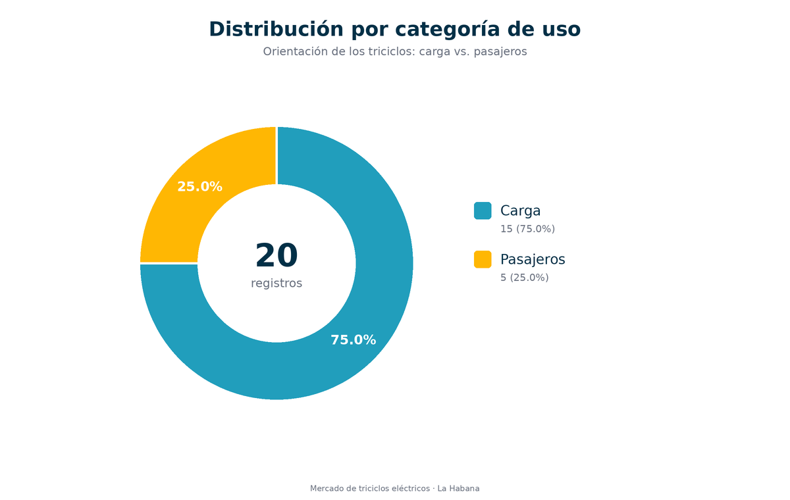
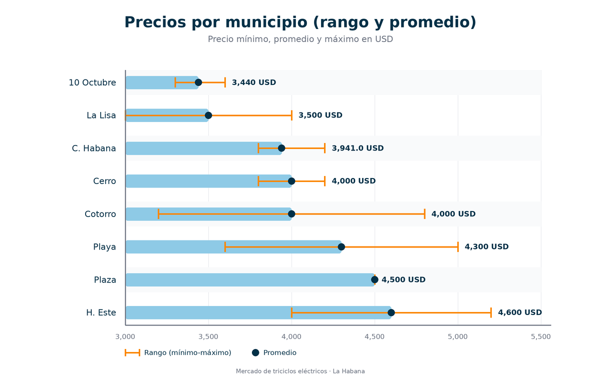

# Mercado de Triciclos Eléctricos de La Habana

Proyecto de ciencia de datos sobre el mercado de triciclos eléctricos en La Habana (Cuba), a partir de datos de anuncios web y entrevistas directas a operadores y compradores.

## Descripción

El análisis caracteriza el mercado actual: precios, distribución geográfica por municipio, categorías de uso (carga vs. pasajeros), barreras legales/operativas y fuentes de adquisición.

## Informe completo

El informe completo, con metodología, resultados, gráficos, limitaciones y recomendaciones, está disponible en:

- [`reporte_completo.pdf`](reporte_completo.pdf) — informe completo (10 páginas)
- [`graficos/reporte_graficos.pdf`](graficos/reporte_graficos.pdf) — resumen gráfico

## Datos

- `datos/datos_consolidados.csv`: 20 registros consolidados (12 de fuente web + 8 de entrevistas).
- `datos/mercadodetriciclos.json`: 12 registros del mercado web (marca, precio, capacidad, potencia, autonomía, legalidad, panel solar).

## Hallazgos principales

- **Precios:** entre 3,000 y 5,200 USD, con un promedio aproximado de 3,941 USD.
- **Ubicación:** 10 de Octubre concentra la mayor cantidad de registros, seguido de Centro Habana.
- **Uso:** predominan los triciclos de carga (15) sobre los de pasajeros (5).
- **Barreras:** falta de documentos, precios altos, burocracia y trámites lentos.
- **Fuentes:** 12 registros web y 8 de entrevistas.

## Gráficos

Galería completa: [`graficos/index.html`](graficos/index.html)

| Gráfico | Archivo |
|---|---|
| Distribución de precios | [`grafico_precios.png`](graficos/grafico_precios.png) |
| Distribución por municipio | [`grafico_municipios.png`](graficos/grafico_municipios.png) |
| Categoría de uso | [`grafico_uso.png`](graficos/grafico_uso.png) |
| Barreras del mercado | [`grafico_barreras.png`](graficos/grafico_barreras.png) |
| Fuentes de datos | [`grafico_fuentes.png`](graficos/grafico_fuentes.png) |
| Precios por municipio | [`grafico_precios_municipio.png`](graficos/grafico_precios_municipio.png) |
| Distribución por marca | [`grafico_marcas.png`](graficos/grafico_marcas.png) |





## Estructura del repositorio

```
proyecto_ciencia_datos/
├── README.md
├── datos/
│   ├── datos_consolidados.csv
│   └── mercadodetriciclos.json
├── introduccion/
│   └── introduccion.md
├── resultados/
│   ├── analisis_completo.json
│   └── resumen_ejecutivo.md
├── graficos/
│   ├── index.html
│   ├── *.png
│   ├── *.svg
│   └── reporte_graficos.pdf
├── generar_graficos.py          # gráficos SVG (solo biblioteca estándar)
├── generar_graficos_png.py      # gráficos PNG (requiere Pillow)
├── generar_reporte_pdf.py       # resumen gráfico en PDF (requiere fpdf)
├── generar_informe_completo.py  # informe completo en PDF (requiere fpdf)
└── reporte_completo.pdf         # informe completo generado
```

## Requisitos

- Python 3
- [Pillow](https://python-pillow.org/) para generar los PNG (`pip install pillow`)
- [fpdf](https://pyfpdf.readthedocs.io/) para el reporte PDF (`pip install fpdf`)

Los gráficos SVG no requieren dependencias externas.

## Cómo ejecutar

```bash
# Gráficos SVG (sin dependencias)
python3 generar_graficos.py

# Gráficos PNG (requiere Pillow)
python3 generar_graficos_png.py

# Reporte PDF (requiere fpdf)
python3 generar_reporte_pdf.py

# Informe completo en PDF (requiere fpdf)
python3 generar_informe_completo.py
```

Los resultados se guardan en la carpeta `graficos/`. Abre `graficos/index.html` para ver la galería.

## Contexto

Análisis con fines académicos y exploratorios. Las cifras provienen de una muestra limitada, por lo que deben interpretarse como una aproximación al mercado y no como un censo.
